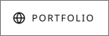
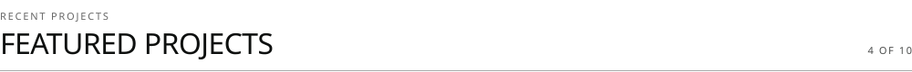

  <picture>
    <source media="(prefers-color-scheme: dark)" srcset="assets/banner-dark.svg" />
    
  </picture>

  <a href="https://calendly.com/franzewilliamcalleja/meet-with-me"><picture><source media="(prefers-color-scheme: dark)" srcset="assets/btn-call-dark.svg" /></picture></a>
  <a href="mailto:franzewilliamcalleja@gmail.com"><picture><source media="(prefers-color-scheme: dark)" srcset="assets/btn-email-dark.svg" /></picture></a>
  <a href="https://www.linkedin.com/in/franze-calleja"><picture><source media="(prefers-color-scheme: dark)" srcset="assets/btn-linkedin-dark.svg" /></picture></a>
  <a href="https://franzecalleja.vercel.app"><picture><source media="(prefers-color-scheme: dark)" srcset="assets/btn-portfolio-dark.svg" /></picture></a>

 

<picture>
  <source media="(prefers-color-scheme: dark)" srcset="assets/header-about-dark.svg" />
  
</picture>

Full-stack software engineer from the Philippines. I build production web, mobile, and AI-powered systems for a university, a Canadian startup, and freelance clients, and I run them too: Docker, CI/CD, and Prometheus/Grafana observability across 10+ services.

Open to part-time roles and freelance projects.

 

<picture>
  <source media="(prefers-color-scheme: dark)" srcset="assets/header-projects-dark.svg" />
  
</picture>

- **[EUC Academic Portal](https://collegeportal.mseufcandelaria.com)**: admissions, enrollment, and grade evaluation for 500+ applicants per term.
- **[MSEUF-Candelaria Portal & CMS](https://mseufcandelaria.com)**: the university's website and custom CMS, with a Gemini RAG chat assistant.
- **[PHD Map](https://phdmap.raones.cloud)**: peer-to-peer parking marketplace for Toronto, on mobile and web.
- **[Kairos](https://github.com/franze-calleja/kairos)**: open-source, self-hosted stock and ETF research tool where every AI claim cites its source.

[All projects →](https://franzecalleja.vercel.app/projects)

 

<picture>
  <source media="(prefers-color-scheme: dark)" srcset="assets/header-stack-dark.svg" />
  
</picture>

<picture>
  <source media="(prefers-color-scheme: dark)" srcset="https://skillicons.dev/icons?i=ts%2Cpy%2Creact%2Cnextjs%2Cnodejs%2Cexpress%2Cfastapi%2Cprisma%2Cpostgres%2Cmysql%2Cdocker%2Cgithubactions%2Cgrafana%2Cprometheus&theme=dark" />
  
</picture>

My portfolio also has an <a href="https://franzecalleja.vercel.app/chat">AI assistant</a> that answers questions about my work.
